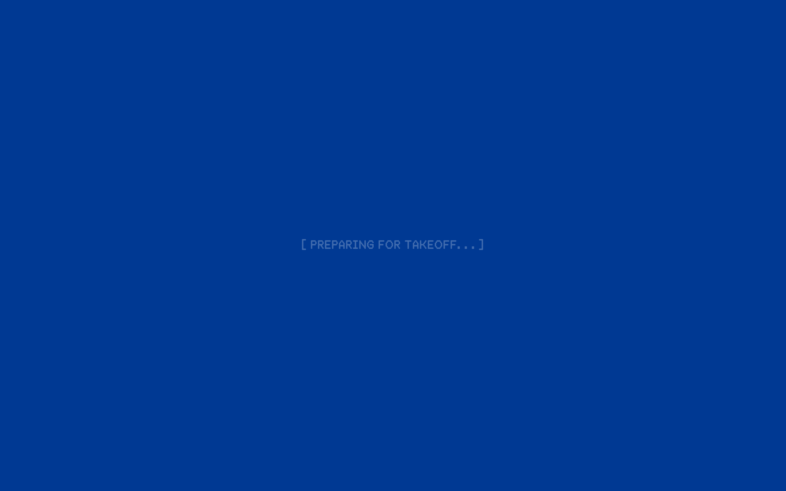
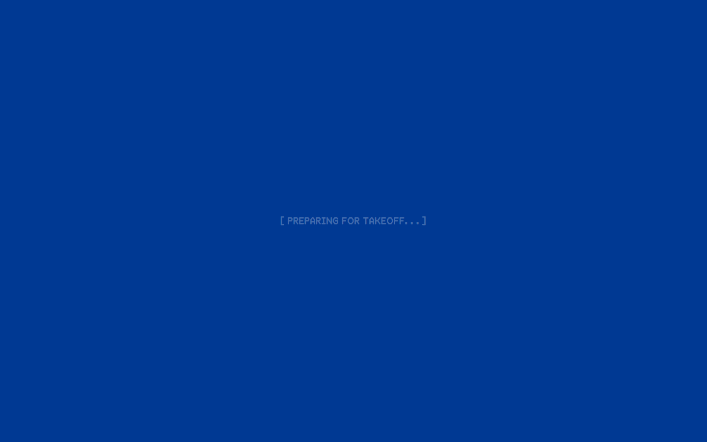
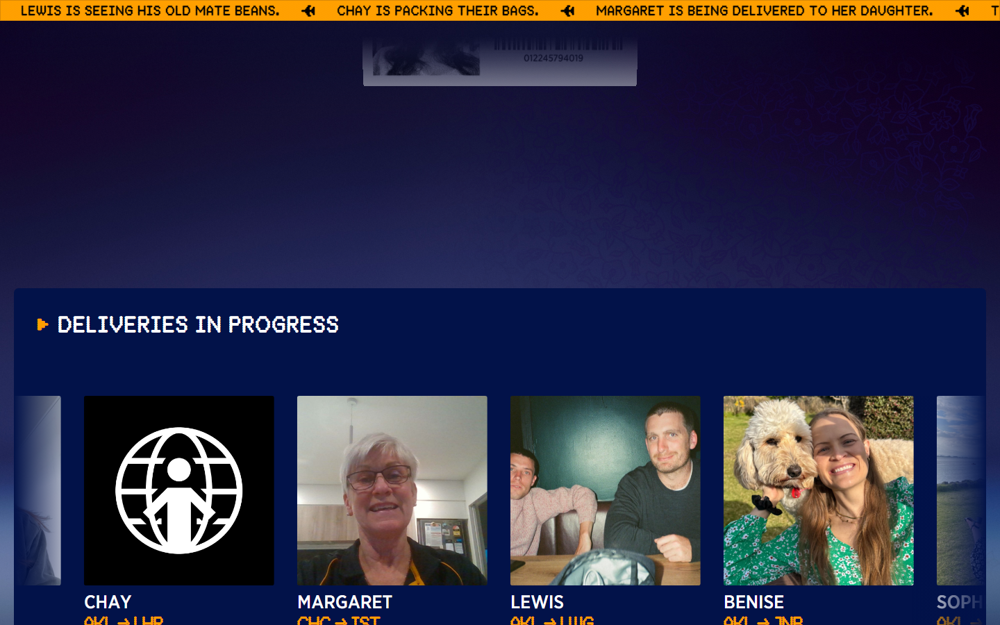
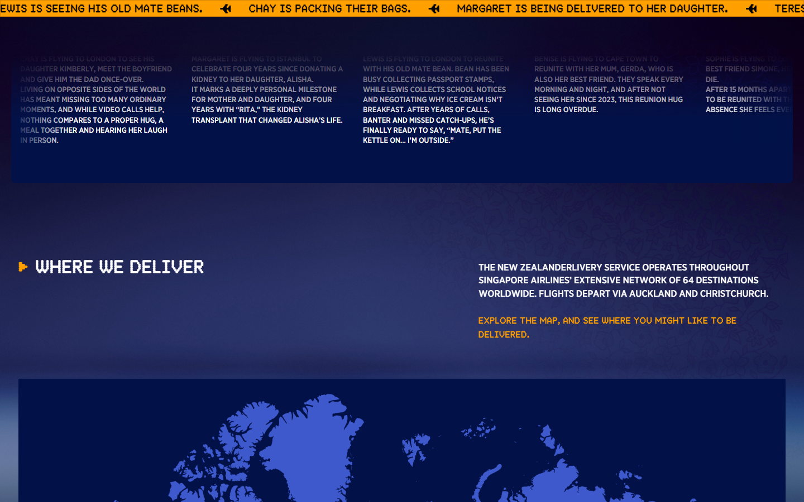
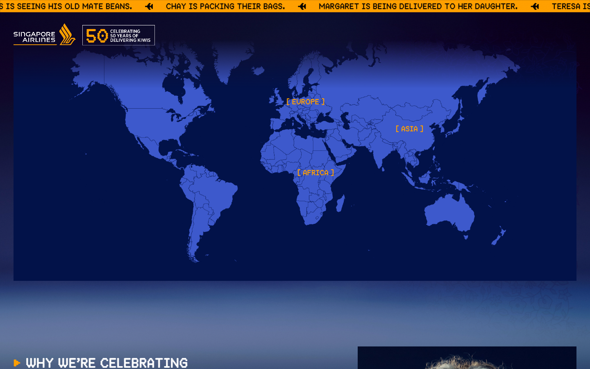
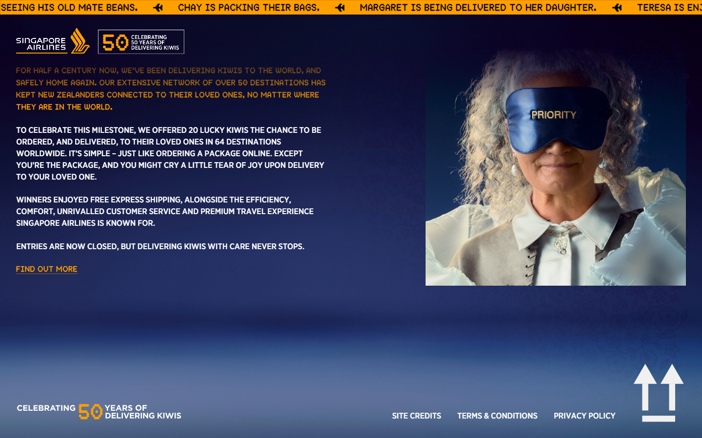
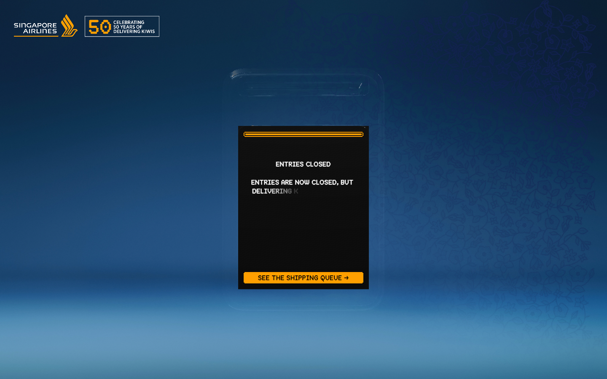
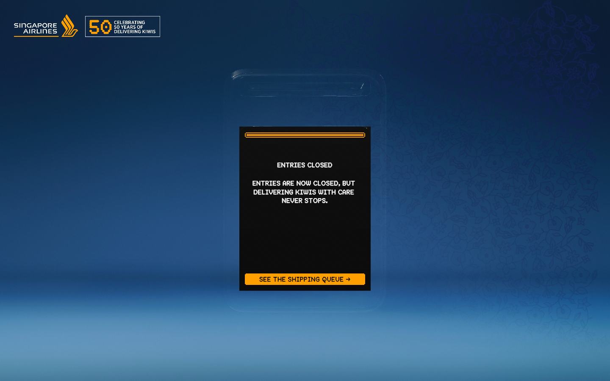
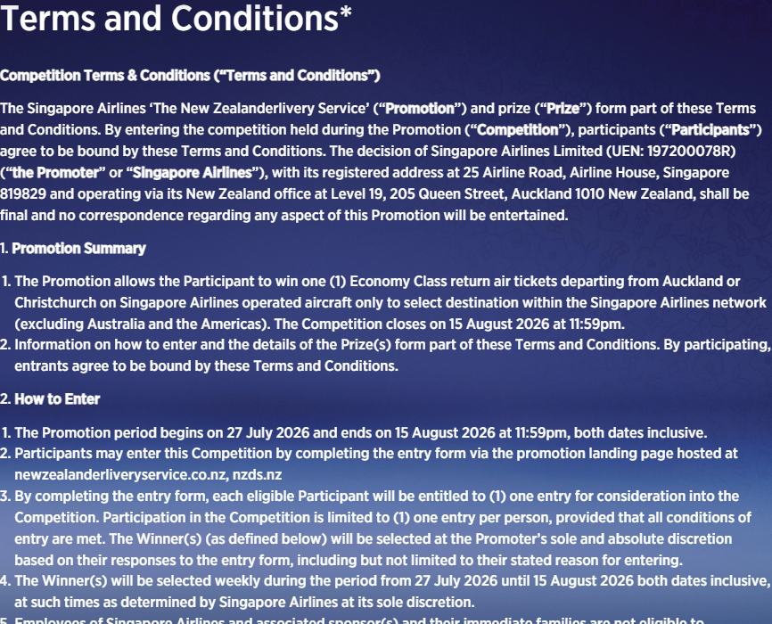

# newzealanderliveryservice Design System

You are building UI for **newzealanderliveryservice**. Dark-themed, warm palette, sans-serif typography (GothamMedium), compact density on a 4px grid, flat elevation (no shadows), expressive motion.

## Visual Reference

**IMPORTANT**: Study ALL screenshots below before writing any UI. Match colors, typography, spacing, layout, and motion exactly as shown.

### Homepage



### Scroll Journey (Cinematic Visual States)

> These screenshots capture the website at different scroll depths. The design changes dramatically as you scroll — each frame shows a different cinematic state. Replicate these exact visual transitions.

#### 0% — Hero / Above the fold


#### 17% — Mid-page at 17% scroll


#### 33% — Mid-page at 33% scroll



#### 50% — Mid-page at 50% scroll



#### 67% — Mid-page at 67% scroll



#### 83% — Mid-page at 83% scroll



#### 100% — Footer / End of page



> Read `references/DESIGN.md` for full token details. Read `references/ANIMATIONS.md` for motion specs. Read `references/LAYOUT.md` for layout structure. Read `references/COMPONENTS.md` for component patterns.

## Ultra Reference Files

This package includes extended documentation. **Read these files before implementing:**

| File | Contents |
|------|----------|
| `references/DESIGN.md` | Full design system tokens, colors, typography, spacing |
| `references/VISUAL_GUIDE.md` | **START HERE** — Master visual guide with all screenshots embedded |
| `references/ANIMATIONS.md` | CSS keyframes, scroll triggers, motion library stack, video specs |
| `references/LAYOUT.md` | Flex/grid containers, page structure, spacing relationships |
| `references/COMPONENTS.md` | DOM component patterns, HTML structure, class fingerprints |
| `references/INTERACTIONS.md` | Hover/focus states with before/after style diffs |
| `screens/scroll/` | 7 scroll journey screenshots showing cinematic states |

### Animation Stack Detected

- **Web Animations API (4 active)** — animation

## Design Philosophy

- **Flat elevation** — depth through color shifts and borders, never shadows. Surfaces get progressively lighter to indicate elevation.
- **Gradient accents** — gradients are used thoughtfully for emphasis, not decoration.
- **Type pairing** — GothamMedium for body/UI text, GothamBold for headings/display. Never introduce a third typeface.
- **compact density** — 4px base grid. Every dimension is a multiple of 4.
- **warm palette** — the color temperature runs warm, matching the sans-serif typography.
- **Restrained accent** — `#cb840e` is the only pop of color. Used exclusively for CTAs, links, focus rings, and active states.
- **Expressive motion** — animations are an integral part of the experience. Use spring physics and layout animations.

## Color System

### Core Palette

| Role | Token | Hex | Use |
|------|-------|-----|-----|
| Background | `--background` | `#000000` | Page/app background |
| Surface | `--surface` | `#10174a` | Cards, panels, modals |
| Text Primary | `--text-primary` | `#ffffff` | Headings, body text |
| Text Muted | `--text-muted` | `#334844` | Captions, placeholders |
| Accent | `--accent` | `#cb840e` | CTAs, links, focus rings |
| Border | `--border` | `#1e1e1e` | Dividers, card borders |

### Status Colors

| Status | Hex | Use |
|--------|-----|-----|
| Warning | `#ff9f00` | Caution states, pending items |

### Extended Palette

- **color-background:** `#003993`
- `#e7e7e7` — Light surface or highlight color
- `#f0f0f0` — Light surface or highlight color
- `#6176c9`

### CSS Variable Tokens

```css
--color-background: #003993;
--color-foreground: #fff;
--color-primary: #fff;
--color-secondary: #334844;
--color-background: #003993;
--color-foreground: #fff;
--color-primary: #fff;
--color-secondary: #334844;
--color-background: #003993;
--color-foreground: #fff;
--color-primary: #fff;
--color-secondary: #334844;
```

## Typography

### Font Stack

- **GothamMedium** — Heading 1, Heading 2, Heading 3
- **GothamBold** — Body, Caption
- **NotoSansMono-Bold** — Code

### Font Sources

```css
@font-face {
  font-family: "GothamBold";
  src: url("fonts/GothamBold-Regular.woff2") format("woff2");
  font-weight: 400;
}
@font-face {
  font-family: "GothamMedium";
  src: url("fonts/GothamMedium-Regular.woff2") format("woff2");
  font-weight: 400;
}
@font-face {
  font-family: "MDThermochromeSemibold";
  src: url("fonts/MDThermochromeSemibold-Regular.woff2") format("woff2");
  font-weight: 400;
}
@font-face {
  font-family: "NotoSans_ExtraCondensed-Bold";
  src: url("fonts/NotoSans_ExtraCondensed-Bold-Regular.woff2") format("woff2");
  font-weight: 400;
}
@font-face {
  font-family: "NotoSansMono-Bold";
  src: url("fonts/NotoSansMono-Bold-Regular.woff2") format("woff2");
  font-weight: 400;
}
```

### Type Scale

| Role | Family | Size | Weight |
|------|--------|------|--------|
| Heading 1 | GothamMedium | 4rem | 700 |
| Heading 2 | GothamMedium | 2.56rem | 700 |
| Heading 3 | GothamMedium | 2.5rem | 700 |
| Body | GothamBold | 1rem | 400 |
| Caption | GothamBold | 1.25rem | 400 |
| Code | NotoSansMono-Bold | 14px | 400 |

### Typography Rules

- Body/UI: **GothamMedium**, Headings: **GothamBold** — these are the only display fonts
- Max 3-4 font sizes per screen
- Headings: weight 600-700, body: weight 400
- Use color and opacity for text hierarchy, not additional font sizes
- Line height: 1.5 for body, 1.2 for headings

## Spacing & Layout

### Base Grid: 4px

Every dimension (margin, padding, gap, width, height) must be a multiple of **4px**.

### Spacing Scale

`2, 4, 6, 8, 10, 12, 16, 18, 20, 22, 24, 30` px

### Spacing as Meaning

| Spacing | Use |
|---------|-----|
| 4-8px | Tight: related items (icon + label, avatar + name) |
| 12-16px | Medium: between groups within a section |
| 24-32px | Wide: between distinct sections |
| 48px+ | Vast: major page section breaks |

### Border Radius

Scale: `.125rem, .25rem, .26rem, .5rem, 3.33333px, 6.66667px`
Default: `.5rem`

### Container

Max-width: `65rem`, centered with auto margins.

### Breakpoints

| Name | Value |
|------|-------|
| sm | 600px |
| lg | 800px |
| lg | 900px |
| xl | 1264px |
| 2xl | 1600px |
| 2xl | 1900px |

Mobile-first: design for small screens, layer on responsive overrides.

## Component Patterns

### Card

```css
.card {
  background: #10174a;
  border: 1px solid #1e1e1e;
  border-radius: .5rem;
  padding: 16px;
}
```

```html
<div class="card">
  <h3>Card Title</h3>
  <p>Card content goes here.</p>
</div>
```

### Button

```css
/* Primary */
.btn-primary {
  background: #cb840e;
  color: #ffffff;
  border-radius: .5rem;
  padding: 8px 16px;
  font-weight: 500;
  transition: opacity 150ms ease;
}
.btn-primary:hover { opacity: 0.9; }

/* Ghost */
.btn-ghost {
  background: transparent;
  border: 1px solid #1e1e1e;
  color: #ffffff;
  border-radius: .5rem;
  padding: 8px 16px;
}
```

```html
<button class="btn-primary">Get Started</button>
<button class="btn-ghost">Learn More</button>
```

### Input

```css
.input {
  background: #000000;
  border: 1px solid #1e1e1e;
  border-radius: .5rem;
  padding: 8px 12px;
  color: #ffffff;
  font-size: 14px;
}
.input:focus { border-color: #cb840e; outline: none; }
```

```html
<input class="input" type="text" placeholder="Search..." />
```

### Badge / Chip

```css
.badge {
  display: inline-flex;
  align-items: center;
  padding: 4px 8px;
  border-radius: 9999px;
  font-size: 12px;
  font-weight: 500;
  background: #10174a;
  color: #334844;
}
```

```html
<span class="badge">New</span>
<span class="badge">Beta</span>
```

### Modal / Dialog

```css
.modal-backdrop { background: rgba(0, 0, 0, 0.6); }
.modal {
  background: #10174a;
  border: 1px solid #1e1e1e;
  border-radius: 6.66667px;
  padding: 24px;
  max-width: 480px;
  width: 90vw;
}
```

```html
<div class="modal-backdrop">
  <div class="modal">
    <h2>Dialog Title</h2>
    <p>Dialog content.</p>
    <button class="btn-primary">Confirm</button>
    <button class="btn-ghost">Cancel</button>
  </div>
</div>
```

### Table

```css
.table { width: 100%; border-collapse: collapse; }
.table th {
  text-align: left;
  padding: 8px 12px;
  font-weight: 500;
  font-size: 12px;
  color: #334844;
  text-transform: uppercase;
  letter-spacing: 0.05em;
  border-bottom: 1px solid #1e1e1e;
}
.table td {
  padding: 12px;
  border-bottom: 1px solid #1e1e1e;
}
```

```html
<table class="table">
  <thead><tr><th>Name</th><th>Status</th><th>Date</th></tr></thead>
  <tbody>
    <tr><td>Item One</td><td>Active</td><td>Jan 1</td></tr>
    <tr><td>Item Two</td><td>Pending</td><td>Jan 2</td></tr>
  </tbody>
</table>
```

### Navigation

```css
.nav {
  display: flex;
  align-items: center;
  gap: 8px;
  padding: 12px 16px;
  border-bottom: 1px solid #1e1e1e;
}
.nav-link {
  color: #334844;
  padding: 8px 12px;
  border-radius: .5rem;
  transition: color 150ms;
}
.nav-link:hover { color: #ffffff; }
.nav-link.active { color: #cb840e; }
```

```html
<nav class="nav">
  <a href="/" class="nav-link active">Home</a>
  <a href="/about" class="nav-link">About</a>
  <a href="/pricing" class="nav-link">Pricing</a>
  <button class="btn-primary" style="margin-left: auto">Get Started</button>
</nav>
```

### Extracted Components

These components were found in the codebase:

**Button** (`html`)

## Page Structure

The following page sections were detected:

- **Hero** — Hero section (detected from heading structure)

When building pages, follow this section order and structure.

## Animation & Motion

This project uses **expressive motion**. Animations are part of the design language.

### CSS Animations

- `bounce-right`
- `bounce-left`
- `spin`
- `pulse`
- `cyber-label-blink`

### Motion Tokens

- **Duration scale:** `.15s`, `.2s`, `.3s`, `.5s`, `1s`, `180ms`
- **Easing functions:** `ease`
- **Animated properties:** `fill`

### Motion Guidelines

- **Duration:** Use values from the duration scale above. Short (.15s) for micro-interactions, long (180ms) for page transitions
- **Easing:** Use `ease` as the default easing curve
- **Direction:** Elements enter from bottom/right, exit to top/left
- **Reduced motion:** Always respect `prefers-reduced-motion` — disable animations when set

## Depth & Elevation

This design uses **flat elevation** — no box-shadows anywhere.

### Elevation Strategy

| Level | Technique | Use |
|-------|-----------|-----|
| 0 — Base | Background color | Page background |
| 1 — Raised | Lighter surface + subtle border | Cards, panels |
| 2 — Floating | Even lighter surface + stronger border | Dropdowns, popovers |
| 3 — Overlay | Backdrop + modal surface | Modals, dialogs |

### Z-Index Scale

`2, 10, 50, 100, 9999, 99999`

Use these exact values — never invent z-index values.

## Anti-Patterns (Never Do)

- **No box-shadow** on any element — use borders and surface colors for depth
- **No blur effects** — no backdrop-blur, no filter: blur()
- **No zebra striping** — tables and lists use borders for separation
- **No invented colors** — every hex value must come from the palette above
- **No arbitrary spacing** — every dimension is a multiple of 4px
- **No extra fonts** — only GothamMedium and GothamBold and NotoSansMono-Bold are allowed
- **No arbitrary border-radius** — use the scale: .125rem, .25rem, .26rem, .5rem, 3.33333px, 6.66667px
- **No opacity for disabled states** — use muted colors instead
- **No pill shapes** — this design doesn't use rounded-full / 9999px radius

## Workflow

1. **Read** `references/DESIGN.md` before writing any UI code
2. **Pick colors** from the Color System section — never invent new ones
3. **Set typography** — GothamMedium, GothamBold, NotoSansMono-Bold only, using the type scale
4. **Build layout** on the 4px grid — check every margin, padding, gap
5. **Match components** to patterns above before creating new ones
6. **Apply elevation** — flat, surface color shifts only
7. **Validate** — every value traces back to a design token. No magic numbers.

## Brand Spec

- **Favicon:** `/favicon.ico`
- **Site URL:** `https://www.newzealanderliveryservice.co.nz/`
- **Brand color:** `#cb840e`
- **Brand typeface:** GothamMedium

## Quick Reference

```
Background:     #000000
Surface:        #10174a
Text:           #ffffff / #334844
Accent:         #cb840e
Border:         #1e1e1e
Font:           GothamMedium
Spacing:        4px grid
Radius:         .5rem
Components:     4 detected
```

## When to Trigger

Activate this skill when:
- Creating new components, pages, or visual elements for newzealanderliveryservice
- Writing CSS, Tailwind classes, styled-components, or inline styles
- Building page layouts, templates, or responsive designs
- Reviewing UI code for design consistency
- The user mentions "newzealanderliveryservice" design, style, UI, or theme
- Generating mockups, wireframes, or visual prototypes

---

# Full Reference Files

> Every output file is embedded below. Claude has full design system context from /skills alone.

## Design System Tokens (DESIGN.md)

# newzealanderliveryservice DESIGN.md

> Auto-generated design system — reverse-engineered via static analysis by skillui.
> Frameworks: None detected
> Colors: 11 · Fonts: 3 · Components: 4
> Icon library: not detected · State: not detected
> Primary theme: dark · Dark mode toggle: no · Motion: expressive

## Visual Reference

**Match this design exactly** — study colors, fonts, spacing, and component shapes before writing any UI code.


---

## 1. Visual Theme & Atmosphere

This is a **dark-themed** interface with a flat, warm visual language. Elevation is achieved through color and border shifts rather than shadows — a clean, industrial aesthetic. Typography pairs **GothamBold** for display/headings with **GothamMedium** for body text, creating clear visual hierarchy through type contrast. Spacing follows a **4px base grid** (compact density), with scale: 2, 4, 6, 8, 10, 12, 16, 18px. The palette is predominantly monochromatic with **#cb840e** as the single accent color — used sparingly for interactive elements and emphasis. Motion is expressive — spring physics, layout animations, and staggered reveals are part of the visual language.

---

## 2. Color Palette & Roles

| Token | Hex | Role | Use |
|---|---|---|---|
| theme-color | `#000000` | background | Page background, darkest surface |
| surface | `#10174a` | surface | Card and panel backgrounds |
| tw-ring-offset-color | `#ffffff` | text-primary | Headings and body text |
| color-secondary | `#334844` | text-muted | Captions, placeholders, secondary info |
| color-charcoal | `#1e1e1e` | border | Dividers, card borders, outlines |
| accent | `#cb840e` | accent | CTAs, links, focus rings, active states |
| color-orange | `#ff9f00` | warning | Warning states, caution indicators |
| color-background | `#003993` | info | Informational highlights |
| unknown | `#e7e7e7` | unknown | Palette color |
| unknown | `#f0f0f0` | unknown | Palette color |
| unknown | `#6176c9` | unknown | Palette color |

### CSS Variable Tokens

```css
--tw-border-style: solid;
--color-background: #003993;
--color-foreground: #fff;
--color-primary: #fff;
--color-secondary: #334844;
--tw-border-style: solid;
--tw-border-style: solid;
--color-background: #003993;
--color-foreground: #fff;
--color-primary: #fff;
--color-secondary: #334844;
--tw-border-style: solid;
--tw-border-style: solid;
--color-background: #003993;
--color-foreground: #fff;
--color-primary: #fff;
--color-secondary: #334844;
--tw-border-style: solid;
```


---

## 3. Typography Rules

**Font Stack:**
- **GothamMedium** — Heading 1, Heading 2, Heading 3
- **GothamBold** — Body, Caption
- **NotoSansMono-Bold** — Code

**Font Sources:**

```css
@font-face {
  font-family: "GothamBold";
  src: url("fonts/GothamBold-Regular.woff2") format("woff2");
  font-weight: 400;
}
@font-face {
  font-family: "GothamMedium";
  src: url("fonts/GothamMedium-Regular.woff2") format("woff2");
  font-weight: 400;
}
@font-face {
  font-family: "MDThermochromeSemibold";
  src: url("fonts/MDThermochromeSemibold-Regular.woff2") format("woff2");
  font-weight: 400;
}
@font-face {
  font-family: "NotoSans_ExtraCondensed-Bold";
  src: url("fonts/NotoSans_ExtraCondensed-Bold-Regular.woff2") format("woff2");
  font-weight: 400;
}
@font-face {
  font-family: "NotoSansMono-Bold";
  src: url("fonts/NotoSansMono-Bold-Regular.woff2") format("woff2");
  font-weight: 400;
}
```

| Role | Font | Size | Weight |
|---|---|---|---|
| Heading 1 | GothamMedium | 4rem | 700 |
| Heading 2 | GothamMedium | 2.56rem | 700 |
| Heading 3 | GothamMedium | 2.5rem | 700 |
| Body | GothamBold | 1rem | 400 |
| Caption | GothamBold | 1.25rem | 400 |
| Code | NotoSansMono-Bold | 14px | 400 |

**Typographic Rules:**
- Limit to 3 font families max per screen
- Use **GothamMedium** for body/UI text, **GothamBold** for display/headings
- Maintain consistent hierarchy: no more than 3-4 font sizes per screen
- Headings use bold (600-700), body uses regular (400)
- Line height: 1.5 for body text, 1.2 for headings
- Use color and opacity for secondary hierarchy, not additional font sizes


---

## 4. Component Stylings

### Data Display (1)

**Badge** — `html`

### Data Input (1)

**Button** — `html`
- Animation: 

### Media (2)

**Image** — `html`

**Icon** — `html`


---

## 5. Layout Principles

- **Base spacing unit:** 4px
- **Spacing scale:** 2, 4, 6, 8, 10, 12, 16, 18, 20, 22, 24, 30
- **Border radius:** .125rem, .25rem, .26rem, .5rem, 3.33333px, 6.66667px
- **Max content width:** 65rem

**Spacing as Meaning:**
| Spacing | Use |
|---|---|
| 4-8px | Tight: related items within a group |
| 12-16px | Medium: between groups |
| 24-32px | Wide: between sections |
| 48px+ | Vast: major section breaks |


---

## 6. Depth & Elevation

No box-shadow values detected. The design uses a **flat visual style** — elevation is conveyed through background color shifts and borders rather than shadows.

**Elevation Strategy:**
| Level | Technique | Use |
|---|---|---|
| 0 — Base | Background color | Page background |
| 1 — Raised | Lighter surface + subtle border | Cards, panels |
| 2 — Floating | Even lighter surface + stronger border | Dropdowns, popovers |
| 3 — Overlay | Backdrop + modal surface | Modals, dialogs |

**Z-Index Scale:** `2, 10, 50, 100, 9999, 99999`


---

## 7. Animation & Motion

This project uses **expressive motion**. Animations are an integral part of the experience.

### CSS Animations

- `@keyframes bounce-right`
- `@keyframes bounce-left`
- `@keyframes spin`
- `@keyframes pulse`
- `@keyframes cyber-label-blink`
- `@keyframes draw-region-arc`
- `@keyframes country-dropdown-in`

### Animated Components

- **Button**: 

### Motion Guidelines

- Duration: 150-300ms for micro-interactions, 300-500ms for page transitions
- Easing: `ease-out` for enters, `ease-in` for exits
- Always respect `prefers-reduced-motion`


---

## 8. Do's and Don'ts

### Do's

- Use `#cb840e` for interactive elements (buttons, links, focus rings)
- Use `#000000` as the primary page background
- Pair **GothamMedium** (body) with **GothamBold** (display) — these are the only allowed fonts
- Follow the **4px** spacing grid for all margins, padding, and gaps
- Use border and background shifts for elevation — not shadows
- Use border-radius from the scale: .125rem, .25rem, .26rem, .5rem, 3.33333px
- Reuse existing components from Section 4 before creating new ones

### Don'ts

- Don't introduce colors outside this palette — extend the design tokens first
- Don't introduce additional font families beyond GothamMedium and GothamBold and NotoSansMono-Bold
- Don't use arbitrary spacing values — stick to multiples of 4px
- Don't add box-shadow — this design system uses flat elevation
- Don't use arbitrary border-radius values — pick from the defined scale
- Don't duplicate component patterns — check Section 4 first
- Don't use backdrop-blur or blur effects

### Anti-Patterns (detected from codebase)

- No box-shadow on any element
- No blur or backdrop-blur effects
- No zebra striping on tables/lists


---

## 9. Responsive Behavior

| Name | Value | Source |
|---|---|---|
| sm | 600px | css |
| lg | 800px | css |
| lg | 900px | css |
| xl | 1264px | css |
| 2xl | 1600px | css |
| 2xl | 1900px | css |

**Approach:** Use `@media (min-width: ...)` queries matching the breakpoints above.


---

## 10. Agent Prompt Guide

Use these as starting points when building new UI:

### Build a Card

```
Background: #10174a
Border: 1px solid #1e1e1e
Radius: .5rem
Padding: 16px
Font: GothamMedium
No shadows — use borders and surface colors for depth.
```

### Build a Button

```
Primary: bg #cb840e, text white
Ghost: bg transparent, border #1e1e1e
Padding: 8px 16px
Radius: .5rem
Hover: opacity 0.9 or lighter shade
Focus: ring with #cb840e
```

### Build a Page Layout

```
Background: #000000
Max-width: 65rem, centered
Grid: 4px base
Responsive: mobile-first, breakpoints from Section 9
```

### Build a Stats Card

```
Surface: #10174a
Label: #334844 (muted, 12px, uppercase)
Value: #ffffff (primary, 24-32px, bold)
Status: use success/warning/danger from Section 2
```

### Build a Form

```
Input bg: #000000
Input border: 1px solid #1e1e1e
Focus: border-color #cb840e
Label: #334844 12px
Spacing: 16px between fields
Radius: .5rem
```

### General Component

```
1. Read DESIGN.md Sections 2-6 for tokens
2. Colors: only from palette
3. Font: GothamMedium, type scale from Section 3
4. Spacing: 4px grid
5. Components: match patterns from Section 4
6. Elevation: flat, surface shifts
```

## Visual Guide — Screenshots (VISUAL_GUIDE.md)

# newzealanderliveryservice — Visual Guide

> Master visual reference. Study every screenshot carefully before implementing any UI.
> Match colors, layout, typography, spacing, and motion states exactly.

**Motion Stack:** **Web Animations API (4 active)**

## Scroll Journey

The page has cinematic scroll animations. Each screenshot below shows the exact visual state at that scroll depth.
**Replicate these transitions precisely** — the design changes dramatically as you scroll.

### Hero — Above the fold

*Scroll position: 0px of 5749px total*


### 17% scroll depth

*Scroll position: 824px of 5749px total*


### 33% scroll depth

*Scroll position: 1600px of 5749px total*


### 50% scroll depth

*Scroll position: 2425px of 5749px total*


### 67% scroll depth

*Scroll position: 3249px of 5749px total*


### 83% scroll depth

*Scroll position: 4025px of 5749px total*


### Footer — End of page

*Scroll position: 4833px of 5749px total*


## Full Page Screenshots

### Home | NZDS - The New Zealanderlivery Service

*URL: `https://www.newzealanderliveryservice.co.nz/`*


### Enter | NZDS - The New Zealanderlivery Service

*URL: `https://www.newzealanderliveryservice.co.nz/enter`*


### Terms & Conditions | NZDS - The New Zealanderlivery Service

*URL: `https://www.newzealanderliveryservice.co.nz/terms-and-conditions`*


## Section Screenshots

Clipped sections showing individual components in context.

### Section 1 — `article`

*1440×1200px*


### Section 1 — `article`

*1440×900px*


### Section 1 — `article`

*867×1200px*


## Animations & Motion (ANIMATIONS.md)

# Animation Reference

> Cinematic motion design extracted from live DOM. Follow these specs exactly to recreate the experience.

## Motion Technology Stack

| Library | Type | Notes |
|---------|------|-------|
| **Web Animations API (4 active)** | animation |  |

## Scroll Journey

The page is **5,749px** tall. Each frame below shows what the user sees at that scroll depth.

> **Use these screenshots to understand WHAT animates, WHEN it animates, and HOW it moves.**

### 0% — Top / Hero
Scroll position: 0px


### 17% — Opening Section
Scroll position: 824px


### 33% — First Feature Section
Scroll position: 1,600px


### 50% — Mid-Page
Scroll position: 2,425px


### 67% — Lower Content
Scroll position: 3,249px


### 83% — Near Footer
Scroll position: 4,025px


### 100% — Bottom / Footer
Scroll position: 4,833px


## CSS Keyframes (10 extracted)

### `@keyframes draw-region-arc`

Duration: `0.55s` · Easing: `ease-out` · Delay: `0s` · Iteration: `1` · Fill: `none`

Used by: `svg.jsx-d06c553568f5d942 path.region-arc-first.jsx-d06c553568f5d942`, `svg.jsx-d06c553568f5d942 path.region-arc-second.jsx-d06c553568f5d942`

```css
@keyframes draw-region-arc {
  0% {
    stroke-dashoffset: 1;
  }
  100% {
    stroke-dashoffset: 0;
  }
}
```

> SVG stroke animation

### `@keyframes draw-region-arc`

Duration: `0.55s` · Easing: `ease-out` · Delay: `0s` · Iteration: `1` · Fill: `none`

Used by: `svg.jsx-d06c553568f5d942 path.region-arc-first.jsx-d06c553568f5d942`, `svg.jsx-d06c553568f5d942 path.region-arc-second.jsx-d06c553568f5d942`

```css
@keyframes draw-region-arc {
  0% {
    stroke-dashoffset: 1;
  }
  100% {
    stroke-dashoffset: 0;
  }
}
```

> SVG stroke animation

### `@keyframes cyber-label-blink`

Duration: `6s` · Easing: `steps(1)` · Delay: `0s` · Iteration: `infinite` · Fill: `none`

Used by: `.region-label.jsx-d06c553568f5d942`

```css
@keyframes cyber-label-blink {
  0%, 2%, 4%, 100% {
    opacity: 1;
    text-shadow: none;
  }
  1%, 3% {
    opacity: 0.08;
    text-shadow: currentcolor 0px 0px 0.45rem;
  }
}
```

> Opacity fade

### `@keyframes cyber-label-blink`

Duration: `6s` · Easing: `steps(1)` · Delay: `0s` · Iteration: `infinite` · Fill: `none`

Used by: `.region-label.jsx-d06c553568f5d942`

```css
@keyframes cyber-label-blink {
  0%, 2%, 4%, 100% {
    opacity: 1;
    text-shadow: none;
  }
  1%, 3% {
    opacity: 0.08;
    text-shadow: currentcolor 0px 0px 0.45rem;
  }
}
```

> Opacity fade

### `@keyframes country-dropdown-in`

Duration: `0.22s` · Easing: `ease-out` · Delay: `0s` · Iteration: `1` · Fill: `forwards`

Used by: `.country-dropdown.jsx-d06c553568f5d942`

```css
@keyframes country-dropdown-in {
  0% {
    opacity: 0;
    transform: translate(-50%, -100%);
  }
  100% {
    opacity: 1;
    transform: translate(-50%, -110%);
  }
}
```

> Fade + motion enter animation

### `@keyframes country-dropdown-in`

Duration: `0.22s` · Easing: `ease-out` · Delay: `0s` · Iteration: `1` · Fill: `forwards`

Used by: `.country-dropdown.jsx-d06c553568f5d942`

```css
@keyframes country-dropdown-in {
  0% {
    opacity: 0;
    transform: translate(-50%, -100%);
  }
  100% {
    opacity: 1;
    transform: translate(-50%, -110%);
  }
}
```

> Fade + motion enter animation

### `@keyframes bounce-right`

```css
@keyframes bounce-right {
  0% {
    opacity: 0;
    transform: translate(-70%);
  }
  50% {
    opacity: 1;
    transform: translate(10%);
  }
  100% {
    opacity: 1;
    transform: translate(0px);
  }
}
```

> Fade + motion enter animation

### `@keyframes bounce-left`

```css
@keyframes bounce-left {
  0% {
    opacity: 0;
    transform: translate(70%);
  }
  50% {
    opacity: 1;
    transform: translate(-10%);
  }
  100% {
    opacity: 1;
    transform: translate(0px);
  }
}
```

> Fade + motion enter animation

### `@keyframes spin`

```css
@keyframes spin {
  100% {
    transform: rotate(1turn);
  }
}
```

> Transform/motion animation

### `@keyframes pulse`

```css
@keyframes pulse {
  50% {
    opacity: 0.5;
  }
}
```

> Opacity fade

## Motion Tokens (CSS Variables)

### Duration Tokens

```css
--default-transition-duration: .15s;
```

### Easing Tokens

```css
--default-transition-timing-function: cubic-bezier(.4,0,.2,1);
--ease-out: cubic-bezier(0,0,.2,1);
--ease-in-out: cubic-bezier(.4,0,.2,1);
```

## Global Transition Declarations

These `transition` values were extracted from CSS rules across the site:

```css
transition: fill 0.18s;
```

## How to Recreate This Motion Design

### Step 1 — Install Dependencies

```bash
```

### Step 2 — Scroll-Reveal Pattern

Elements that animate into view follow this pattern:

```css
/* Initial hidden state */
.reveal {
  opacity: 0;
  transform: translateY(40px);
  transition: opacity .15s cubic-bezier(.4,0,.2,1),
              transform .15s cubic-bezier(.4,0,.2,1);
}
.reveal.visible {
  opacity: 1;
  transform: translateY(0);
}
```

### Step 3 — Key Motion Principles

- **Duration scale:** `.15s` · `0.18s` — use these values, never invent new durations
- **Always add** `@media (prefers-reduced-motion: reduce) { * { animation-duration: 0.01ms !important; transition-duration: 0.01ms !important; } }`

### Step 4 — Scroll Journey Reference

Match what happens at each scroll position:

- **0%** (`0px`) → `screens/scroll/scroll-000.png`
- **17%** (`824px`) → `screens/scroll/scroll-017.png`
- **33%** (`1600px`) → `screens/scroll/scroll-033.png`
- **50%** (`2425px`) → `screens/scroll/scroll-050.png`
- **67%** (`3249px`) → `screens/scroll/scroll-067.png`
- **83%** (`4025px`) → `screens/scroll/scroll-083.png`
- **100%** (`4833px`) → `screens/scroll/scroll-100.png`

## Layout & Grid (LAYOUT.md)

# Layout Reference

> Auto-extracted from live DOM. Use this to understand how the site is structured spatially.

## Spacing System

**Base grid:** 4px

**Scale:** `2, 4, 6, 8, 10, 12, 16, 18, 20, 22, 24, 30, 32, 36, 40` px

| Spacing | Semantic Use |
|---------|-------------|
| 4px | Tight — within a component |
| 8px | Medium — between sibling items |
| 16px | Wide — between sections |
| 32px | Vast — major section breaks |

## Flex Layouts

| Element | Direction | Justify | Align | Gap | Children |
|---------|-----------|---------|-------|-----|----------|
| `div.w-full.h-full` | row | center | center | — | 1 |
| `div#Home.w-full.flex` | column | — | — | — | 1 |
| `div.landing-recent-deliveries.mb-[5rem]` | column | — | — | 16.6667px | 1 |
| `div.w-full.mb-[5rem]` | column | start | start | 66.6667px | 2 |
| `div.landing-about.w-full` | row | start | center | 200px | 2 |
| `div.w-full.relative` | column | center | center | — | 1 |
| `div.desktop:absolute.desktop:top-0` | column | center | — | — | 3 |
| `div.desktop:absolute.desktop:top-0` | row | space-between | center | — | 2 |
| `div.absolute.left-[5%]` | row | space-between | center | — | 2 |
| `div.w-full.flex` | column | — | — | 80px | 2 |
| `div.w-full.flex` | row | space-between | start | 0px | 2 |
| `div.w-full.h-full` | column | center | — | — | 4 |
| `div.w-full.px-[1rem]` | row | space-between | end | 66.6667px | 2 |
| `div.px-[1rem].desktop:px-[2.5rem]` | row | space-between | center | — | 1 |
| `div.carousel.w-full` | row | — | — | — | 14 |

## Structural Containers

### `<article>` 

```
display:          block
children:         7
```

## Layout Rules

- Primary layout system: **Flexbox**
- Every spacing value must be a multiple of **4px**
- Never use arbitrary margin/padding values outside the spacing scale

## Component Patterns (COMPONENTS.md)

# Component Reference

> Repeated DOM patterns detected by structural analysis. Each component appeared 3+ times.

## Detected Components

| Component | Category | Instances | Key Classes |
|-----------|----------|-----------|-------------|
| **Carousel Snap** | unknown | 11× | `.carousel-snap`, `.desktop:pl-[2.5rem]`, `.desktop:w-[23rem]` |
| **Aspect Square** | unknown | 11× | `.aspect-square`, `.h-full`, `.object-center` |
| **!Mb 0** | unknown | 11× | `.!mb-0`, `.!mt-[0.75rem]`, `.leading-none` |
| **!Mb 0** | unknown | 11× | `.!mb-0`, `.!mt-[0.37rem]`, `.font-secondary` |
| **Flex** | unknown | 11× | `.flex`, `.flex-col`, `.gap-[0.25rem]` |
| **Whitespace Pre Line** | unknown | 11× | `.whitespace-pre-line` |
| **Absolute** | unknown | 6× | `.absolute`, `.duration-200`, `.h-full` |
| **Jsx D06c553568f5d942** | unknown | 3× | `.jsx-d06c553568f5d942` |

## Other Components

### Carousel Snap

**Instances found:** 11

**CSS classes:** `.carousel-snap` `.desktop:pl-[2.5rem]` `.desktop:w-[23rem]` `.flex` `.flex-col` `.pl-[2rem]`

**HTML structure:**

```html
<div class="carousel-snap w-[16rem] desktop:w-[23rem] pl-[2rem] desktop:pl-[2.5rem] flex flex-col" style="position: absolute; left: 0px; top: 0px; transition: none; user-select: none; transform: translateX(-142.969px);"><p class="type-body leading-none text-[1rem] md:text-[2rem] !mt-[0.75rem] !mb-0 uppercase">Emma</p><p class="type-body leading-none text-[1rem] md:text-[2.125rem] text-orange f
```

**Base styles (from design tokens):**

```css
.carousel-snap {
  background: #10174a;
  padding: 4px;
}```

### Aspect Square

**Instances found:** 11

**CSS classes:** `.aspect-square` `.h-full` `.object-center` `.object-cover` `.pointer-events-none` `.rounded-sm`

**HTML structure:**

```html

```

**Base styles (from design tokens):**

```css
.aspect-square {
  background: #10174a;
  padding: 4px;
}```

### !Mb 0

**Instances found:** 11

**CSS classes:** `.!mb-0` `.!mt-[0.75rem]` `.leading-none` `.text-[1rem]` `.type-body` `.uppercase`

**HTML structure:**

```html
<p class="type-body leading-none text-[1rem] md:text-[2rem] !mt-[0.75rem] !mb-0 uppercase">Emma</p>
```

**Base styles (from design tokens):**

```css
.!mb-0 {
  background: #10174a;
  padding: 4px;
}```

### !Mb 0

**Instances found:** 11

**CSS classes:** `.!mb-0` `.!mt-[0.37rem]` `.font-secondary` `.leading-none` `.text-[1rem]` `.text-orange`

**HTML structure:**

```html
<p class="type-body leading-none text-[1rem] md:text-[2.125rem] text-orange font-secondary !mt-[0.37rem] !mb-0 uppercase">AKL → LHR</p>
```

**Base styles (from design tokens):**

```css
.!mb-0 {
  background: #10174a;
  padding: 4px;
}```

### Flex

**Instances found:** 11

**CSS classes:** `.flex` `.flex-col` `.gap-[0.25rem]` `.leading-snug` `.mt-[0.5rem]` `.text-[0.8rem]`

**HTML structure:**

```html
<div class="flex flex-col gap-[0.25rem] mt-[0.5rem] text-[0.8rem] md:text-[1rem] leading-snug"><p class="whitespace-pre-line">Emma is flying to London to surprise her…</p></div>
```

**Base styles (from design tokens):**

```css
.flex {
  background: #10174a;
  padding: 4px;
}```

### Whitespace Pre Line

**Instances found:** 11

**CSS classes:** `.whitespace-pre-line`

**HTML structure:**

```html
<p class="whitespace-pre-line">Emma is flying to London to surprise her long-distance best friend, Tasha, at her University graduation. After years of airport goodbyes, FaceTime calls and a well-overdue matching friendship anklet revamp, this reunion means the world.</p>
```

**Base styles (from design tokens):**

```css
.whitespace-pre-line {
  background: #10174a;
  padding: 4px;
}```

### Absolute

**Instances found:** 6

**CSS classes:** `.absolute` `.duration-200` `.h-full` `.jsx-d06c553568f5d942` `.left-0` `.object-cover`

**HTML structure:**

```html

```

**Base styles (from design tokens):**

```css
.absolute {
  background: #10174a;
  padding: 4px;
}```

### Jsx D06c553568f5d942

**Instances found:** 3

**CSS classes:** `.jsx-d06c553568f5d942`

**HTML structure:**

```html
<path id="HoverAfrica" fill="#ffffff" fill-opacity="0" fill-rule="evenodd" stroke="none" d="M 450 403 L 482 373 L 531 366 L 570 382 L 598 388 L 628 452 L 652 450 L 652 517 L 651 558 L 625 576 L 595 590 L 566 600 L 548 593 L 523 539 L 523 505 L 508 479 L 469 479 L 443 463 L 434 428 L 450 403 Z" class="jsx-d06c553568f5d942"></path>
```

**Base styles (from design tokens):**

```css
.jsx-d06c553568f5d942 {
  background: #10174a;
  padding: 4px;
}```

## Component Rules

- Match class names exactly from the patterns above
- Each component instance must be visually identical to others of its type
- Do not add extra wrappers or change the DOM structure
- Use `#1e1e1e` for all dividers within components
- Use `#cb840e` for all interactive/active states

## Interactions & States (INTERACTIONS.md)

# Interaction Reference

> Micro-interactions extracted from live DOM. Recreate these exactly for authentic feel.

## Coverage

| Component Type | Count | States Captured |
|----------------|-------|----------------|
| Link | 3 | default, hover, focus |

## Transition System

These transition declarations were extracted from interactive elements:

```css
transition: all;
transition: 0.15s cubic-bezier(0.4, 0, 0.2, 1);
```

Apply these to all interactive elements. Never invent new durations or easings.

## Link Interactions

### Link 1 — `ENTER NOW`

**States:**

- Default: `../screens/states/link-1-default.png`
- Hover: `../screens/states/link-1-hover.png`
- Focus: `../screens/states/link-1-focus.png`

**On focus:**

```css
/* outline: rgb(255, 255, 255) none 3px → */ outline: rgb(16, 16, 16) auto 1px;
/* outline-color: rgb(255, 255, 255) → */ outline-color: rgb(16, 16, 16);
```

**Transition:** `all`

### Link 2 — `ENTRIES CLOSED`

**States:**

- Default: `../screens/states/link-2-default.png`
- Focus: `../screens/states/link-2-focus.png`

**On focus:**

```css
/* outline: rgb(255, 255, 255) none 3px → */ outline: rgb(16, 16, 16) auto 1px;
/* outline-color: rgb(255, 255, 255) → */ outline-color: rgb(16, 16, 16);
```

**Transition:** `all`

### Link 3 — `FIND OUT MORE`

**States:**

- Default: `../screens/states/link-3-default.png`
- Focus: `../screens/states/link-3-focus.png`

**On focus:**

```css
/* outline: rgb(255, 159, 0) none 3px → */ outline: rgb(16, 16, 16) auto 1px;
/* outline-color: rgb(255, 159, 0) → */ outline-color: rgb(16, 16, 16);
```

**Transition:** `0.15s cubic-bezier(0.4, 0, 0.2, 1)`

## Interaction Rules

- Accent color `#cb840e` is used for focus rings, active states, and hover highlights
- Focus states use **outline** (not box-shadow) — always match the extracted focus ring
- Transition durations in use: `0.15s`
- Always respect `prefers-reduced-motion` — set all transitions to `0s` when enabled

## Design Tokens — JSON Files

### tokens/colors.json
```json
{
  "$schema": "https://design-tokens.github.io/community-group/format/",
  "core": {
    "text-primary": {
      "value": "#ffffff",
      "role": "text-primary",
      "name": "tw-ring-offset-color"
    },
    "background": {
      "value": "#000000",
      "role": "background",
      "name": "theme-color"
    },
    "surface": {
      "value": "#10174a",
      "role": "surface"
    },
    "border": {
      "value": "#1e1e1e",
      "role": "border",
      "name": "color-charcoal"
    },
    "text-muted": {
      "value": "#334844",
      "role": "text-muted",
      "name": "color-secondary"
    },
    "accent": {
      "value": "#cb840e",
      "role": "accent"
    }
  },
  "status": {
    "warning": {
      "value": "#ff9f00",
      "role": "warning",
      "name": "color-orange"
    }
  },
  "extended": {
    "color-background": {
      "value": "#003993",
      "role": "info",
      "name": "color-background"
    },
    "color-e7e7e7": {
      "value": "#e7e7e7",
      "role": "unknown"
    },
    "color-f0f0f0": {
      "value": "#f0f0f0",
      "role": "unknown"
    },
    "color-6176c9": {
      "value": "#6176c9",
      "role": "unknown"
    }
  },
  "meta": {
    "theme": "dark",
    "extracted": "2026-09-25"
  }
}
```

### tokens/spacing.json
```json
{
  "base": {
    "value": "4px",
    "description": "Grid unit — all spacing must be multiples of this"
  },
  "unit": "px",
  "scale": {
    "xs": {
      "value": "2px",
      "px": 2
    },
    "sm": {
      "value": "4px",
      "px": 4
    },
    "md": {
      "value": "6px",
      "px": 6
    },
    "lg": {
      "value": "8px",
      "px": 8
    },
    "xl": {
      "value": "10px",
      "px": 10
    },
    "2xl": {
      "value": "12px",
      "px": 12
    },
    "3xl": {
      "value": "16px",
      "px": 16
    },
    "4xl": {
      "value": "18px",
      "px": 18
    },
    "5xl": {
      "value": "20px",
      "px": 20
    },
    "6xl": {
      "value": "22px",
      "px": 22
    }
  },
  "multipliers": {
    "1x": {
      "value": "4px",
      "raw": 4
    },
    "2x": {
      "value": "8px",
      "raw": 8
    },
    "3x": {
      "value": "12px",
      "raw": 12
    },
    "4x": {
      "value": "16px",
      "raw": 16
    },
    "5x": {
      "value": "20px",
      "raw": 20
    },
    "6x": {
      "value": "24px",
      "raw": 24
    },
    "7x": {
      "value": "28px",
      "raw": 28
    },
    "8x": {
      "value": "32px",
      "raw": 32
    },
    "9x": {
      "value": "36px",
      "raw": 36
    },
    "10x": {
      "value": "40px",
      "raw": 40
    },
    "11x": {
      "value": "44px",
      "raw": 44
    },
    "12x": {
      "value": "48px",
      "raw": 48
    },
    "13x": {
      "value": "52px",
      "raw": 52
    },
    "14x": {
      "value": "56px",
      "raw": 56
    },
    "15x": {
      "value": "60px",
      "raw": 60
    },
    "16x": {
      "value": "64px",
      "raw": 64
    }
  },
  "meta": {
    "totalValues": 15,
    "min": 2,
    "max": 40
  }
}
```

### tokens/typography.json
```json
{
  "families": [
    "GothamMedium",
    "GothamBold",
    "NotoSansMono-Bold"
  ],
  "scale": {
    "heading-1": {
      "fontFamily": "GothamMedium",
      "fontSize": "4rem",
      "fontWeight": "700",
      "lineHeight": null,
      "source": "css"
    },
    "heading-2": {
      "fontFamily": "GothamMedium",
      "fontSize": "2.56rem",
      "fontWeight": "700",
      "lineHeight": null,
      "source": "css"
    },
    "heading-3": {
      "fontFamily": "GothamMedium",
      "fontSize": "2.5rem",
      "fontWeight": "700",
      "lineHeight": null,
      "source": "css"
    },
    "body": {
      "fontFamily": "GothamBold",
      "fontSize": "1rem",
      "fontWeight": "400",
      "lineHeight": null,
      "source": "css"
    },
    "caption": {
      "fontFamily": "GothamBold",
      "fontSize": "1.25rem",
      "fontWeight": "400",
      "lineHeight": null,
      "source": "css"
    },
    "code": {
      "fontFamily": "NotoSansMono-Bold",
      "fontSize": "14px",
      "fontWeight": "400",
      "lineHeight": null,
      "source": "css"
    }
  },
  "fontFaces": [
    {
      "family": "GothamBold",
      "src": "https://www.newzealanderliveryservice.co.nz/_next/static/media/GothamNarrow-Bold.123e163e.woff2",
      "format": "woff2",
      "weight": "400"
    },
    {
      "family": "GothamMedium",
      "src": "https://www.newzealanderliveryservice.co.nz/_next/static/media/GothamNarrow-Medium.dcabd60d.woff2",
      "format": "woff2",
      "weight": "400"
    },
    {
      "family": "MDThermochromeSemibold",
      "src": "https://www.newzealanderliveryservice.co.nz/_next/static/media/MDThermochrome0.4-Semibold-Trial.86c3e5c5.woff2",
      "format": "woff2",
      "weight": "400"
    },
    {
      "family": "NotoSans_ExtraCondensed-Bold",
      "src": "https://www.newzealanderliveryservice.co.nz/_next/static/media/NotoSans_ExtraCondensed-Bold.985d9adf.woff2",
      "format": "woff2",
      "weight": "400"
    },
    {
      "family": "NotoSansMono-Bold",
      "src": "https://www.newzealanderliveryservice.co.nz/_next/static/media/NotoSansMono-Bold.f4352d62.woff2",
      "format": "woff2",
      "weight": "400"
    }
  ],
  "rules": {
    "maxSizesPerScreen": 4,
    "headingWeightRange": "600-700",
    "bodyWeight": 400,
    "lineHeightBody": 1.5,
    "lineHeightHeading": 1.2
  }
}
```

## Bundled Fonts (fonts/)

The following font files are bundled in the `fonts/` directory:

- `fonts/GothamBold-Regular.woff2`
- `fonts/GothamMedium-Regular.woff2`
- `fonts/MDThermochromeSemibold-Regular.woff2`
- `fonts/NotoSansMono-Bold-Regular.woff2`
- `fonts/NotoSans_ExtraCondensed-Bold-Regular.woff2`

Use these local font files in `@font-face` declarations instead of fetching from Google Fonts.

## Screenshots Inventory (screens/)

> Study all screenshots carefully before implementing any UI. Match every visual detail exactly.

### Scroll Journey (screens/scroll/)

*Cinematic scroll states — page visual at each scroll depth*


### Full Page Screenshots (screens/pages/)

*Full-page screenshots of each crawled URL*




### Section Clips (screens/sections/)

*Clipped individual sections and components*






### Interaction States (screens/states/)

*Hover, focus, and active state captures*


### Screenshot Index (screens/INDEX.md)

# Screenshot Index

## Scroll Journey

> Shows the cinematic state at each point of the page

| Scroll | Y Position | File |
|--------|-----------|------|
| 0% | 0px | `screens/scroll/scroll-000.png` |
| 17% | 824px | `screens/scroll/scroll-017.png` |
| 33% | 1600px | `screens/scroll/scroll-033.png` |
| 50% | 2425px | `screens/scroll/scroll-050.png` |
| 67% | 3249px | `screens/scroll/scroll-067.png` |
| 83% | 4025px | `screens/scroll/scroll-083.png` |
| 100% | 4833px | `screens/scroll/scroll-100.png` |

## Pages

| Page | URL | File |
|------|-----|------|
| Home | NZDS - The New Zealanderlivery Service | `https://www.newzealanderliveryservice.co.nz/` | `screens/pages/home.png` |
| Enter | NZDS - The New Zealanderlivery Service | `https://www.newzealanderliveryservice.co.nz/enter` | `screens/pages/enter.png` |
| Terms & Conditions | NZDS - The New Zealanderlivery Service | `https://www.newzealanderliveryservice.co.nz/terms-and-conditions` | `screens/pages/terms-and-conditions.png` |

## Sections

| Page | Section | File |
|------|---------|------|
| home | #1 (article) | `screens/sections/home-section-1.png` |
| enter | #1 (article) | `screens/sections/enter-section-1.png` |
| terms-and-conditions | #1 (article) | `screens/sections/terms-and-conditions-section-1.png` |

## Homepage Screenshots (screenshots/)


