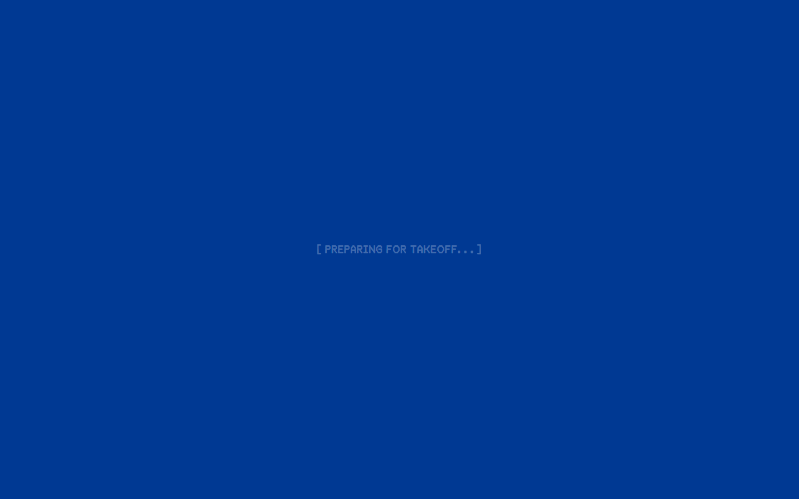
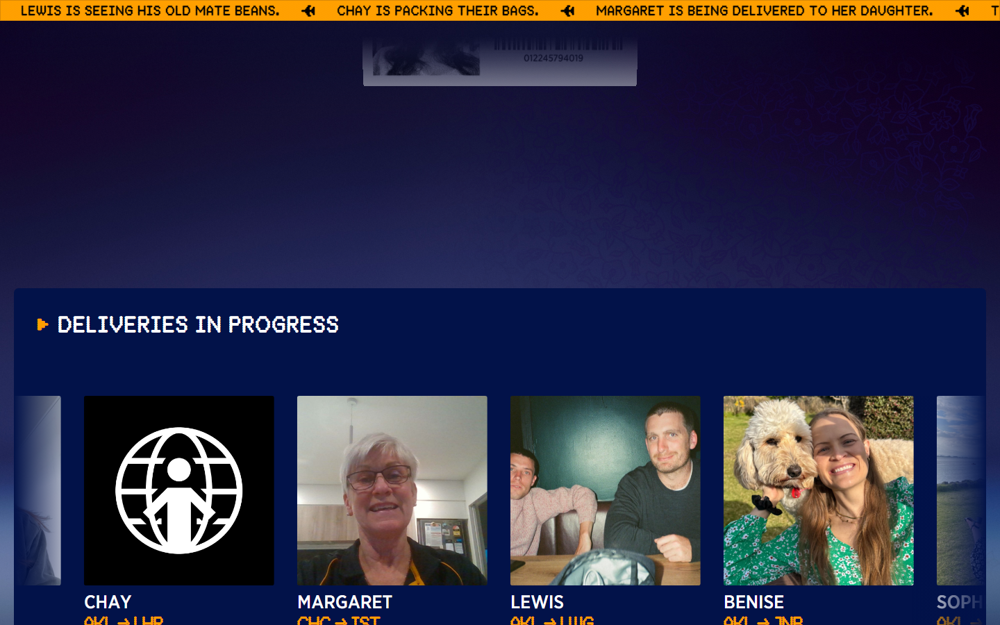
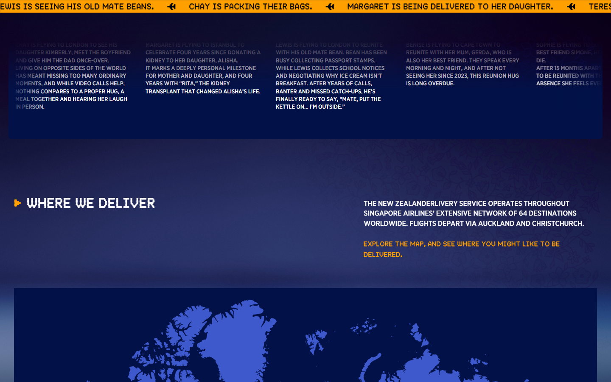
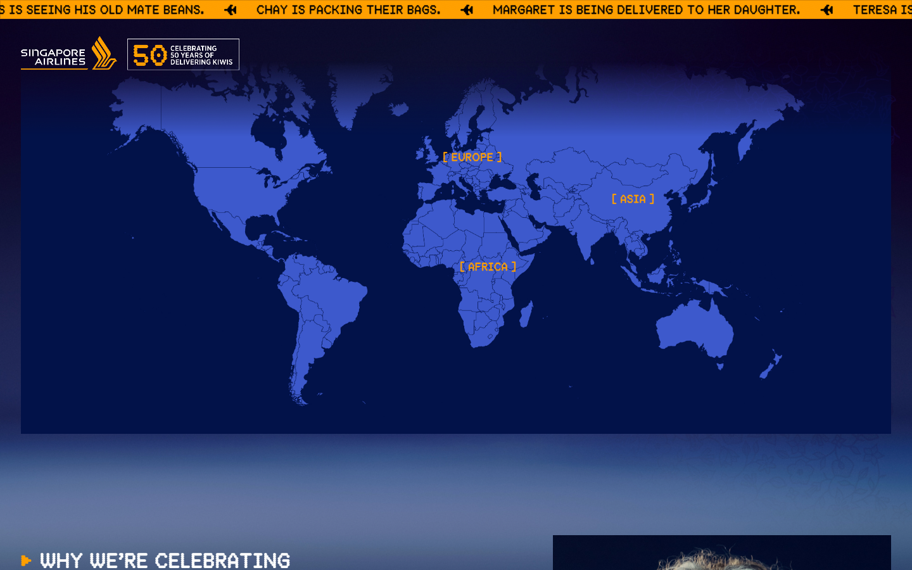
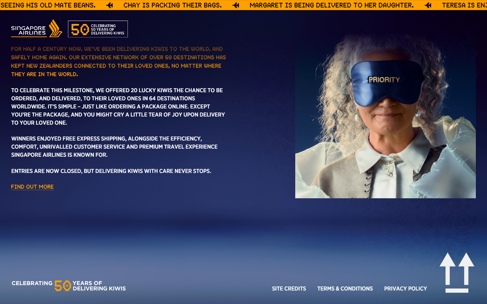

# Animation Reference

> Cinematic motion design extracted from live DOM. Follow these specs exactly to recreate the experience.

## Motion Technology Stack

| Library | Type | Notes |
|---------|------|-------|
| **Web Animations API (4 active)** | animation |  |

## Scroll Journey

The page is **5,749px** tall. Each frame below shows what the user sees at that scroll depth.

> **Use these screenshots to understand WHAT animates, WHEN it animates, and HOW it moves.**

### 0% — Top / Hero
Scroll position: 0px


### 17% — Opening Section
Scroll position: 824px


### 33% — First Feature Section
Scroll position: 1,600px



### 50% — Mid-Page
Scroll position: 2,425px



### 67% — Lower Content
Scroll position: 3,249px



### 83% — Near Footer
Scroll position: 4,025px



### 100% — Bottom / Footer
Scroll position: 4,833px



## CSS Keyframes (10 extracted)

### `@keyframes draw-region-arc`

Duration: `0.55s` · Easing: `ease-out` · Delay: `0s` · Iteration: `1` · Fill: `none`

Used by: `svg.jsx-d06c553568f5d942 path.region-arc-first.jsx-d06c553568f5d942`, `svg.jsx-d06c553568f5d942 path.region-arc-second.jsx-d06c553568f5d942`

```css
@keyframes draw-region-arc {
  0% {
    stroke-dashoffset: 1;
  }
  100% {
    stroke-dashoffset: 0;
  }
}
```

> SVG stroke animation

### `@keyframes draw-region-arc`

Duration: `0.55s` · Easing: `ease-out` · Delay: `0s` · Iteration: `1` · Fill: `none`

Used by: `svg.jsx-d06c553568f5d942 path.region-arc-first.jsx-d06c553568f5d942`, `svg.jsx-d06c553568f5d942 path.region-arc-second.jsx-d06c553568f5d942`

```css
@keyframes draw-region-arc {
  0% {
    stroke-dashoffset: 1;
  }
  100% {
    stroke-dashoffset: 0;
  }
}
```

> SVG stroke animation

### `@keyframes cyber-label-blink`

Duration: `6s` · Easing: `steps(1)` · Delay: `0s` · Iteration: `infinite` · Fill: `none`

Used by: `.region-label.jsx-d06c553568f5d942`

```css
@keyframes cyber-label-blink {
  0%, 2%, 4%, 100% {
    opacity: 1;
    text-shadow: none;
  }
  1%, 3% {
    opacity: 0.08;
    text-shadow: currentcolor 0px 0px 0.45rem;
  }
}
```

> Opacity fade

### `@keyframes cyber-label-blink`

Duration: `6s` · Easing: `steps(1)` · Delay: `0s` · Iteration: `infinite` · Fill: `none`

Used by: `.region-label.jsx-d06c553568f5d942`

```css
@keyframes cyber-label-blink {
  0%, 2%, 4%, 100% {
    opacity: 1;
    text-shadow: none;
  }
  1%, 3% {
    opacity: 0.08;
    text-shadow: currentcolor 0px 0px 0.45rem;
  }
}
```

> Opacity fade

### `@keyframes country-dropdown-in`

Duration: `0.22s` · Easing: `ease-out` · Delay: `0s` · Iteration: `1` · Fill: `forwards`

Used by: `.country-dropdown.jsx-d06c553568f5d942`

```css
@keyframes country-dropdown-in {
  0% {
    opacity: 0;
    transform: translate(-50%, -100%);
  }
  100% {
    opacity: 1;
    transform: translate(-50%, -110%);
  }
}
```

> Fade + motion enter animation

### `@keyframes country-dropdown-in`

Duration: `0.22s` · Easing: `ease-out` · Delay: `0s` · Iteration: `1` · Fill: `forwards`

Used by: `.country-dropdown.jsx-d06c553568f5d942`

```css
@keyframes country-dropdown-in {
  0% {
    opacity: 0;
    transform: translate(-50%, -100%);
  }
  100% {
    opacity: 1;
    transform: translate(-50%, -110%);
  }
}
```

> Fade + motion enter animation

### `@keyframes bounce-right`

```css
@keyframes bounce-right {
  0% {
    opacity: 0;
    transform: translate(-70%);
  }
  50% {
    opacity: 1;
    transform: translate(10%);
  }
  100% {
    opacity: 1;
    transform: translate(0px);
  }
}
```

> Fade + motion enter animation

### `@keyframes bounce-left`

```css
@keyframes bounce-left {
  0% {
    opacity: 0;
    transform: translate(70%);
  }
  50% {
    opacity: 1;
    transform: translate(-10%);
  }
  100% {
    opacity: 1;
    transform: translate(0px);
  }
}
```

> Fade + motion enter animation

### `@keyframes spin`

```css
@keyframes spin {
  100% {
    transform: rotate(1turn);
  }
}
```

> Transform/motion animation

### `@keyframes pulse`

```css
@keyframes pulse {
  50% {
    opacity: 0.5;
  }
}
```

> Opacity fade

## Motion Tokens (CSS Variables)

### Duration Tokens

```css
--default-transition-duration: .15s;
```

### Easing Tokens

```css
--default-transition-timing-function: cubic-bezier(.4,0,.2,1);
--ease-out: cubic-bezier(0,0,.2,1);
--ease-in-out: cubic-bezier(.4,0,.2,1);
```

## Global Transition Declarations

These `transition` values were extracted from CSS rules across the site:

```css
transition: fill 0.18s;
```

## How to Recreate This Motion Design

### Step 1 — Install Dependencies

```bash
```

### Step 2 — Scroll-Reveal Pattern

Elements that animate into view follow this pattern:

```css
/* Initial hidden state */
.reveal {
  opacity: 0;
  transform: translateY(40px);
  transition: opacity .15s cubic-bezier(.4,0,.2,1),
              transform .15s cubic-bezier(.4,0,.2,1);
}
.reveal.visible {
  opacity: 1;
  transform: translateY(0);
}
```

### Step 3 — Key Motion Principles

- **Duration scale:** `.15s` · `0.18s` — use these values, never invent new durations
- **Always add** `@media (prefers-reduced-motion: reduce) { * { animation-duration: 0.01ms !important; transition-duration: 0.01ms !important; } }`

### Step 4 — Scroll Journey Reference

Match what happens at each scroll position:

- **0%** (`0px`) → `screens/scroll/scroll-000.png`
- **17%** (`824px`) → `screens/scroll/scroll-017.png`
- **33%** (`1600px`) → `screens/scroll/scroll-033.png`
- **50%** (`2425px`) → `screens/scroll/scroll-050.png`
- **67%** (`3249px`) → `screens/scroll/scroll-067.png`
- **83%** (`4025px`) → `screens/scroll/scroll-083.png`
- **100%** (`4833px`) → `screens/scroll/scroll-100.png`

