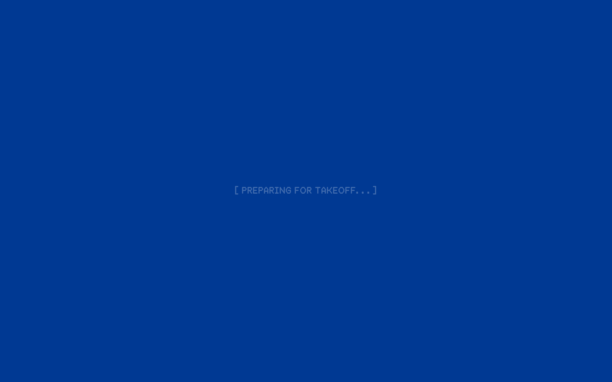

# newzealanderliveryservice DESIGN.md

> Auto-generated design system — reverse-engineered via static analysis by skillui.
> Frameworks: None detected
> Colors: 11 · Fonts: 3 · Components: 4
> Icon library: not detected · State: not detected
> Primary theme: dark · Dark mode toggle: no · Motion: expressive

## Visual Reference

**Match this design exactly** — study colors, fonts, spacing, and component shapes before writing any UI code.



---

## 1. Visual Theme & Atmosphere

This is a **dark-themed** interface with a flat, warm visual language. Elevation is achieved through color and border shifts rather than shadows — a clean, industrial aesthetic. Typography pairs **GothamBold** for display/headings with **GothamMedium** for body text, creating clear visual hierarchy through type contrast. Spacing follows a **4px base grid** (compact density), with scale: 2, 4, 6, 8, 10, 12, 16, 18px. The palette is predominantly monochromatic with **#cb840e** as the single accent color — used sparingly for interactive elements and emphasis. Motion is expressive — spring physics, layout animations, and staggered reveals are part of the visual language.

---

## 2. Color Palette & Roles

| Token | Hex | Role | Use |
|---|---|---|---|
| theme-color | `#000000` | background | Page background, darkest surface |
| surface | `#10174a` | surface | Card and panel backgrounds |
| tw-ring-offset-color | `#ffffff` | text-primary | Headings and body text |
| color-secondary | `#334844` | text-muted | Captions, placeholders, secondary info |
| color-charcoal | `#1e1e1e` | border | Dividers, card borders, outlines |
| accent | `#cb840e` | accent | CTAs, links, focus rings, active states |
| color-orange | `#ff9f00` | warning | Warning states, caution indicators |
| color-background | `#003993` | info | Informational highlights |
| unknown | `#e7e7e7` | unknown | Palette color |
| unknown | `#f0f0f0` | unknown | Palette color |
| unknown | `#6176c9` | unknown | Palette color |

### CSS Variable Tokens

```css
--tw-border-style: solid;
--color-background: #003993;
--color-foreground: #fff;
--color-primary: #fff;
--color-secondary: #334844;
--tw-border-style: solid;
--tw-border-style: solid;
--color-background: #003993;
--color-foreground: #fff;
--color-primary: #fff;
--color-secondary: #334844;
--tw-border-style: solid;
--tw-border-style: solid;
--color-background: #003993;
--color-foreground: #fff;
--color-primary: #fff;
--color-secondary: #334844;
--tw-border-style: solid;
```


---

## 3. Typography Rules

**Font Stack:**
- **GothamMedium** — Heading 1, Heading 2, Heading 3
- **GothamBold** — Body, Caption
- **NotoSansMono-Bold** — Code

**Font Sources:**

```css
@font-face {
  font-family: "GothamBold";
  src: url("fonts/GothamBold-Regular.woff2") format("woff2");
  font-weight: 400;
}
@font-face {
  font-family: "GothamMedium";
  src: url("fonts/GothamMedium-Regular.woff2") format("woff2");
  font-weight: 400;
}
@font-face {
  font-family: "MDThermochromeSemibold";
  src: url("fonts/MDThermochromeSemibold-Regular.woff2") format("woff2");
  font-weight: 400;
}
@font-face {
  font-family: "NotoSans_ExtraCondensed-Bold";
  src: url("fonts/NotoSans_ExtraCondensed-Bold-Regular.woff2") format("woff2");
  font-weight: 400;
}
@font-face {
  font-family: "NotoSansMono-Bold";
  src: url("fonts/NotoSansMono-Bold-Regular.woff2") format("woff2");
  font-weight: 400;
}
```

| Role | Font | Size | Weight |
|---|---|---|---|
| Heading 1 | GothamMedium | 4rem | 700 |
| Heading 2 | GothamMedium | 2.56rem | 700 |
| Heading 3 | GothamMedium | 2.5rem | 700 |
| Body | GothamBold | 1rem | 400 |
| Caption | GothamBold | 1.25rem | 400 |
| Code | NotoSansMono-Bold | 14px | 400 |

**Typographic Rules:**
- Limit to 3 font families max per screen
- Use **GothamMedium** for body/UI text, **GothamBold** for display/headings
- Maintain consistent hierarchy: no more than 3-4 font sizes per screen
- Headings use bold (600-700), body uses regular (400)
- Line height: 1.5 for body text, 1.2 for headings
- Use color and opacity for secondary hierarchy, not additional font sizes


---

## 4. Component Stylings

### Data Display (1)

**Badge** — `html`

### Data Input (1)

**Button** — `html`
- Animation: 

### Media (2)

**Image** — `html`

**Icon** — `html`


---

## 5. Layout Principles

- **Base spacing unit:** 4px
- **Spacing scale:** 2, 4, 6, 8, 10, 12, 16, 18, 20, 22, 24, 30
- **Border radius:** .125rem, .25rem, .26rem, .5rem, 3.33333px, 6.66667px
- **Max content width:** 65rem

**Spacing as Meaning:**
| Spacing | Use |
|---|---|
| 4-8px | Tight: related items within a group |
| 12-16px | Medium: between groups |
| 24-32px | Wide: between sections |
| 48px+ | Vast: major section breaks |


---

## 6. Depth & Elevation

No box-shadow values detected. The design uses a **flat visual style** — elevation is conveyed through background color shifts and borders rather than shadows.

**Elevation Strategy:**
| Level | Technique | Use |
|---|---|---|
| 0 — Base | Background color | Page background |
| 1 — Raised | Lighter surface + subtle border | Cards, panels |
| 2 — Floating | Even lighter surface + stronger border | Dropdowns, popovers |
| 3 — Overlay | Backdrop + modal surface | Modals, dialogs |

**Z-Index Scale:** `2, 10, 50, 100, 9999, 99999`


---

## 7. Animation & Motion

This project uses **expressive motion**. Animations are an integral part of the experience.

### CSS Animations

- `@keyframes bounce-right`
- `@keyframes bounce-left`
- `@keyframes spin`
- `@keyframes pulse`
- `@keyframes cyber-label-blink`
- `@keyframes draw-region-arc`
- `@keyframes country-dropdown-in`

### Animated Components

- **Button**: 

### Motion Guidelines

- Duration: 150-300ms for micro-interactions, 300-500ms for page transitions
- Easing: `ease-out` for enters, `ease-in` for exits
- Always respect `prefers-reduced-motion`


---

## 8. Do's and Don'ts

### Do's

- Use `#cb840e` for interactive elements (buttons, links, focus rings)
- Use `#000000` as the primary page background
- Pair **GothamMedium** (body) with **GothamBold** (display) — these are the only allowed fonts
- Follow the **4px** spacing grid for all margins, padding, and gaps
- Use border and background shifts for elevation — not shadows
- Use border-radius from the scale: .125rem, .25rem, .26rem, .5rem, 3.33333px
- Reuse existing components from Section 4 before creating new ones

### Don'ts

- Don't introduce colors outside this palette — extend the design tokens first
- Don't introduce additional font families beyond GothamMedium and GothamBold and NotoSansMono-Bold
- Don't use arbitrary spacing values — stick to multiples of 4px
- Don't add box-shadow — this design system uses flat elevation
- Don't use arbitrary border-radius values — pick from the defined scale
- Don't duplicate component patterns — check Section 4 first
- Don't use backdrop-blur or blur effects

### Anti-Patterns (detected from codebase)

- No box-shadow on any element
- No blur or backdrop-blur effects
- No zebra striping on tables/lists


---

## 9. Responsive Behavior

| Name | Value | Source |
|---|---|---|
| sm | 600px | css |
| lg | 800px | css |
| lg | 900px | css |
| xl | 1264px | css |
| 2xl | 1600px | css |
| 2xl | 1900px | css |

**Approach:** Use `@media (min-width: ...)` queries matching the breakpoints above.


---

## 10. Agent Prompt Guide

Use these as starting points when building new UI:

### Build a Card

```
Background: #10174a
Border: 1px solid #1e1e1e
Radius: .5rem
Padding: 16px
Font: GothamMedium
No shadows — use borders and surface colors for depth.
```

### Build a Button

```
Primary: bg #cb840e, text white
Ghost: bg transparent, border #1e1e1e
Padding: 8px 16px
Radius: .5rem
Hover: opacity 0.9 or lighter shade
Focus: ring with #cb840e
```

### Build a Page Layout

```
Background: #000000
Max-width: 65rem, centered
Grid: 4px base
Responsive: mobile-first, breakpoints from Section 9
```

### Build a Stats Card

```
Surface: #10174a
Label: #334844 (muted, 12px, uppercase)
Value: #ffffff (primary, 24-32px, bold)
Status: use success/warning/danger from Section 2
```

### Build a Form

```
Input bg: #000000
Input border: 1px solid #1e1e1e
Focus: border-color #cb840e
Label: #334844 12px
Spacing: 16px between fields
Radius: .5rem
```

### General Component

```
1. Read DESIGN.md Sections 2-6 for tokens
2. Colors: only from palette
3. Font: GothamMedium, type scale from Section 3
4. Spacing: 4px grid
5. Components: match patterns from Section 4
6. Elevation: flat, surface shifts
```
