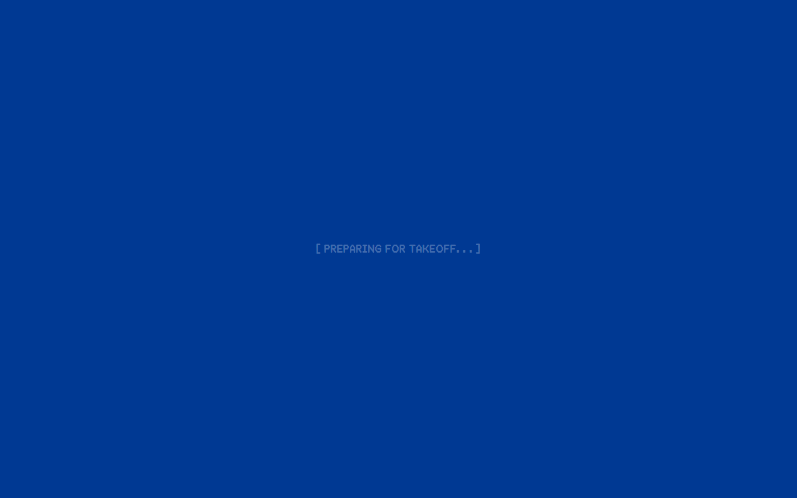
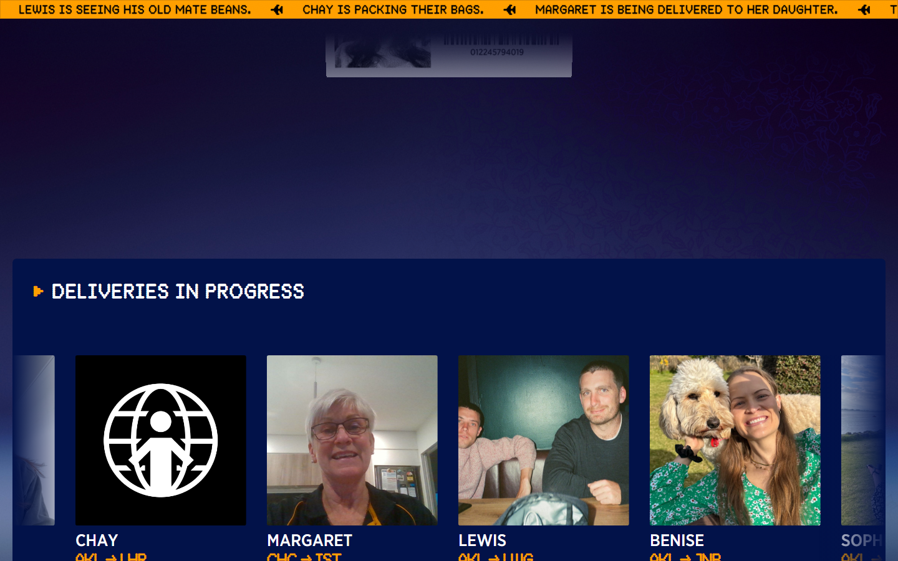
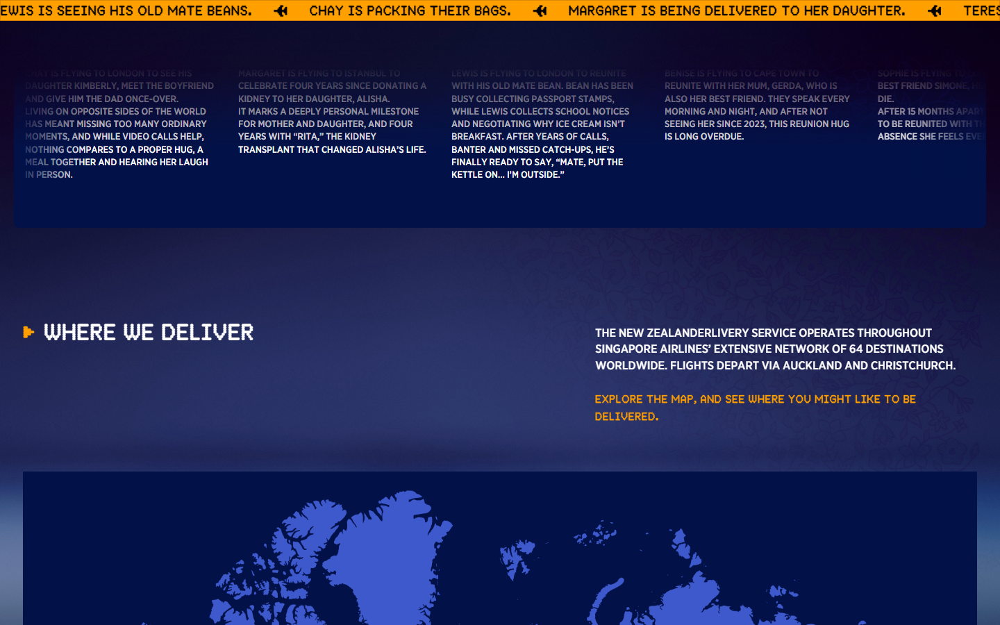
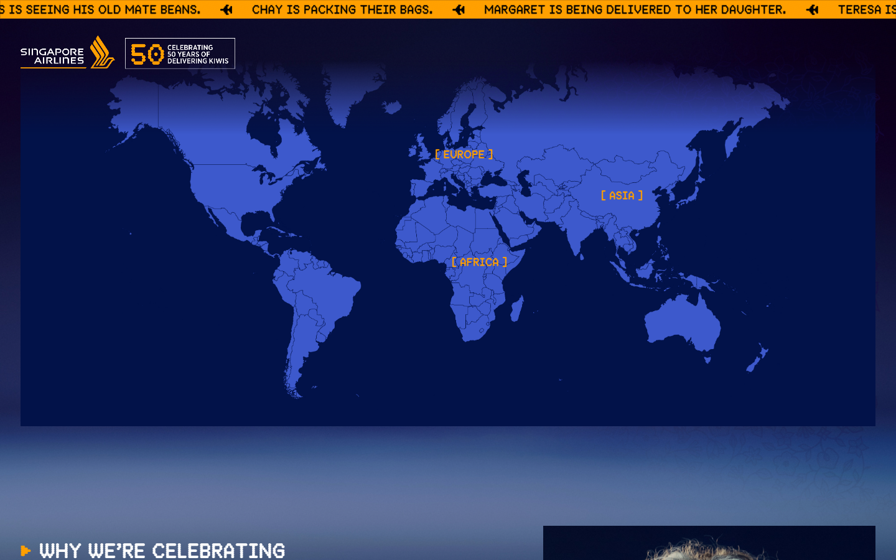
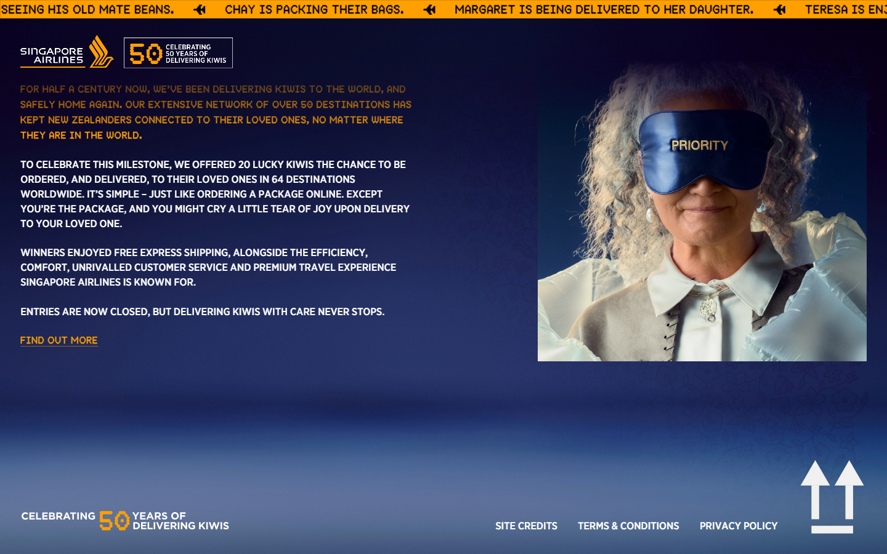
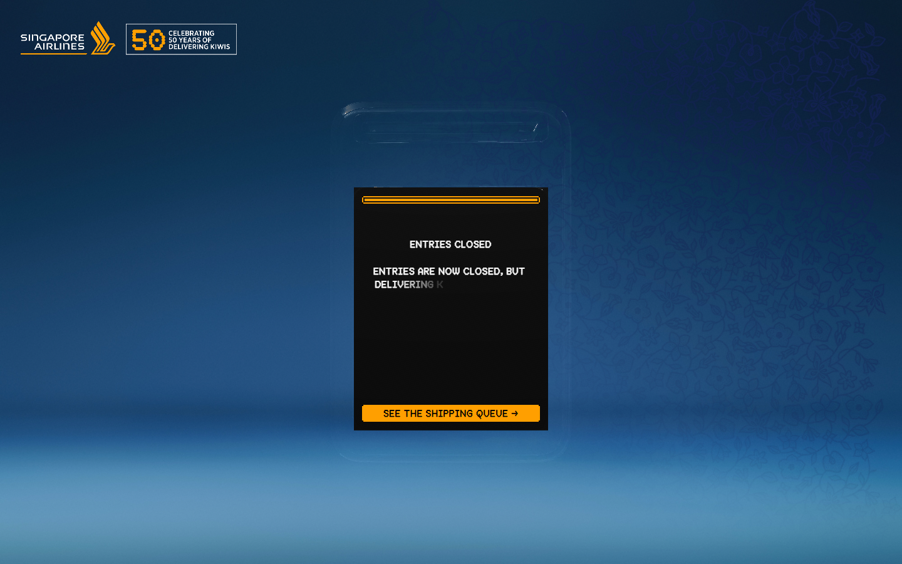
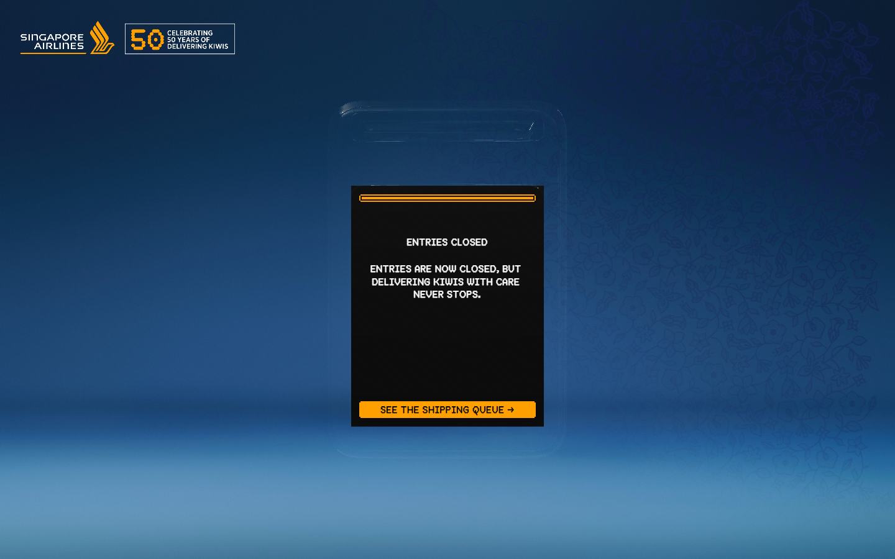
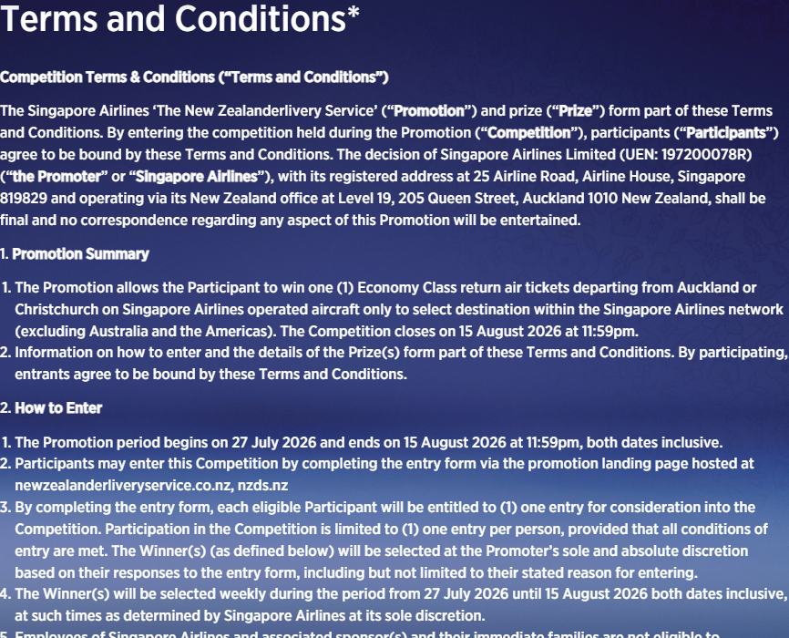

# newzealanderliveryservice — Visual Guide

> Master visual reference. Study every screenshot carefully before implementing any UI.
> Match colors, layout, typography, spacing, and motion states exactly.

**Motion Stack:** **Web Animations API (4 active)**

## Scroll Journey

The page has cinematic scroll animations. Each screenshot below shows the exact visual state at that scroll depth.
**Replicate these transitions precisely** — the design changes dramatically as you scroll.

### Hero — Above the fold

*Scroll position: 0px of 5749px total*

### 17% scroll depth

*Scroll position: 824px of 5749px total*

### 33% scroll depth

*Scroll position: 1600px of 5749px total*

### 50% scroll depth

*Scroll position: 2425px of 5749px total*

### 67% scroll depth

*Scroll position: 3249px of 5749px total*

### 83% scroll depth

*Scroll position: 4025px of 5749px total*

### Footer — End of page

*Scroll position: 4833px of 5749px total*

## Full Page Screenshots

### Home | NZDS - The New Zealanderlivery Service

*URL: `https://www.newzealanderliveryservice.co.nz/`*

### Enter | NZDS - The New Zealanderlivery Service

*URL: `https://www.newzealanderliveryservice.co.nz/enter`*

### Terms & Conditions | NZDS - The New Zealanderlivery Service

*URL: `https://www.newzealanderliveryservice.co.nz/terms-and-conditions`*

## Section Screenshots

Clipped sections showing individual components in context.

### Section 1 — `article`

*1440×1200px*

### Section 1 — `article`

*1440×900px*

### Section 1 — `article`

*867×1200px*

